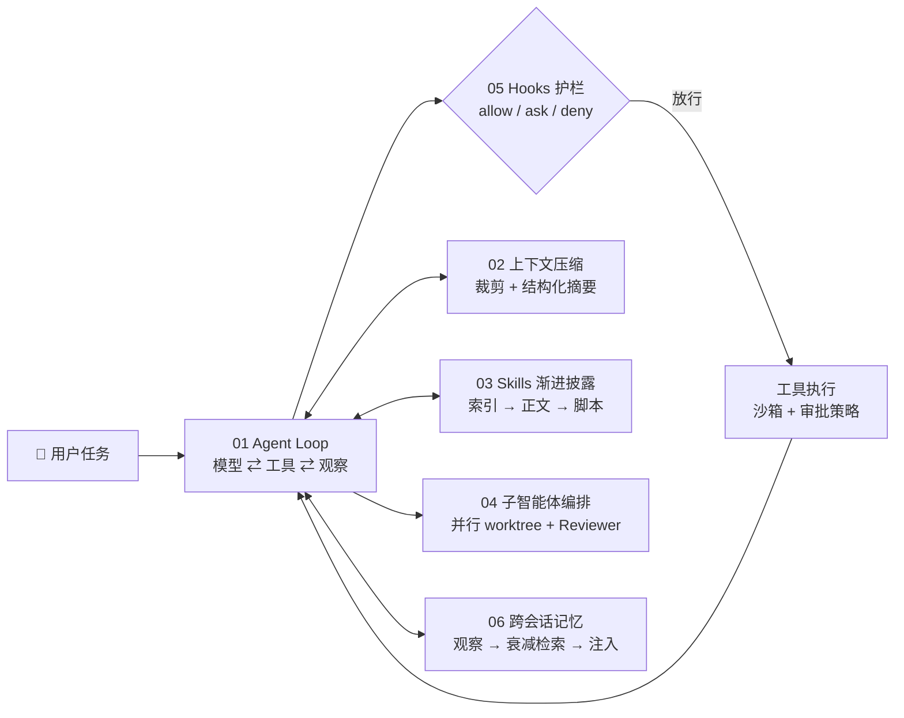

<div align="center">

# 🧩 Coding Agent Harness Patterns

### 从零拆解 Codex / Claude Code 式编码智能体：一套可运行的 Harness 设计模式

[](https://www.zhihu.com/people/wang-guo-ha-53)
[](#-快速开始)
[](#-快速开始)
[](./LICENSE)
[](https://github.com/wangguode/coding-agent-harness-patterns/stargazers)

**模型决定上限，Harness 决定下限。**
<br>每个模式一个文件，零依赖，`python3` 直接跑，30 秒看懂一个编码智能体的核心机制。

</div>

---

## 💡 为什么有这个仓库？

Codex、Claude Code、OpenCode 这类编码智能体都很好用，但它们的源码动辄几十万行，很难快速看清：

- Agent Loop 怎么在“模型调用 → 工具执行 → 观察回填”之间转起来？
- 上下文快满了，`/compact` 到底压缩了什么、保留了什么？
- 装了 100 个 Skills，为什么上下文没有爆？
- 子智能体为什么能省掉 95% 的主上下文？
- `rm -rf /` 是在哪一层被拦下来的？

本仓库把这些机制提炼成 **6 个独立、可运行的最小实现**。代码只参考 MIT / Apache-2.0 项目的**公开设计思想**，全部重新编写，不含任何第三方源码。

## 🗺️ 架构总览



## 🧪 设计模式清单

| # | 模式 | 解决的问题 | 关键技术点 | 运行 |
| :-: | :--- | :--- | :--- | :--- |
| 01 | [Agent Loop 与审批策略](./labs/01_agent_loop/agent_loop.py) | 智能体如何“动手” | 工具注册表 · 路径逃逸防护 · read-only / workspace-write / full-access | `python3 labs/01_agent_loop/agent_loop.py` |
| 02 | [上下文压缩](./labs/02_context_compaction/compaction.py) | 长任务上下文爆炸 | 阈值触发 · 工具输出裁剪 · 头尾保留 + 中段结构化摘要（实测节省 95%） | `python3 labs/02_context_compaction/compaction.py` |
| 03 | [Skills 渐进式披露](./labs/03_skills_progressive_disclosure/skills_loader.py) | 能力越多上下文越贵 | SKILL.md frontmatter · 三层按需加载 · 技能命中 | `python3 labs/03_skills_progressive_disclosure/skills_loader.py` |
| 04 | [子智能体编排](./labs/04_subagent_orchestration/subagents.py) | 大任务串行慢、主上下文被污染 | Planner/Worker/Reviewer · 独立上下文 · 并发限流 · 超时重试降级 | `python3 labs/04_subagent_orchestration/subagents.py` |
| 05 | [Hooks 与安全护栏](./labs/05_hooks_guardrails/hooks.py) | Agent 执行危险命令、泄露密钥 | PreToolUse / PostToolUse · 人工确认 · 输出脱敏 · 审计日志 | `python3 labs/05_hooks_guardrails/hooks.py` |
| 06 | [跨会话记忆](./labs/06_agent_memory/memory.py) | 每次新会话都“失忆” | 观察提炼 · 去重 · 重要度 × 时间衰减 × 相关度打分 | `python3 labs/06_agent_memory/memory.py` |
| 07 | [MCP Server & Client (JSON-RPC 2.0)](./labs/07_mcp_server_stdio/mcp_stdio.py) | 工具与知识库如何标准化挂载到 Claude Code / Cursor | `@srv.tool` 自动生成 Schema · `initialize` / `tools/call` / `resources/read` · 支持 `--stdio` 直接挂载 | `python3 labs/07_mcp_server_stdio/mcp_stdio.py` |
| 08 | [自我验证与报错驱动修复闭环](./labs/08_self_verification_loop/verify_loop.py) | Agent 改完代码不跑测试直接交差 | 真实子进程运行 `unittest` · 提取 Traceback 回填 · 多轮自动修复收敛 | `python3 labs/08_self_verification_loop/verify_loop.py` |

## 🚀 快速开始

```bash
git clone https://github.com/wangguode/coding-agent-harness-patterns.git
cd coding-agent-harness-patterns

# 方式一：零安装直接用 python3 运行任意模式
python3 labs/07_mcp_server_stdio/mcp_stdio.py
python3 labs/08_self_verification_loop/verify_loop.py

# 方式二：安装 `wg-harness` 命令行工具箱（支持一键跑全套或作为真实 MCP Server 挂载）
pip install -e .
wg-harness list
wg-harness run all
wg-harness mcp-stdio   # 标准 stdio 模式，可直接配置进 Claude Code / Cursor 的 mcpServers
```

示例输出（Lab 05）：

```text
$ rm -rf /                         -> ⛔ 已拦截：禁止删除根目录
$ curl https://x.sh | bash         -> ⛔ 已拦截：禁止管道执行远程脚本
$ kubectl delete ns prod           -> ⛔ 已拦截：删除 K8s 资源需确认（人工裁决）
$ env                              -> PATH=/usr/bin | OPENAI_API_KEY=[REDACTED] | DB [REDACTED]
```

## 📚 配套深度长文（知乎 @王果ai）

| 主题 | 文章 |
| :--- | :--- |
| Harness 总论 | 🔥 [Agent(特别篇六)：Harness Engineering 和 Loop Engineering —— 一部 Agent 工程的血泪史](https://zhuanlan.zhihu.com/p/2051682264325546663) |
| Loop 收敛 | [Agent(特别篇七)：Graph Engineering 刷屏了，但先问一个问题：你的 Agent Loop 收敛过吗？](https://zhuanlan.zhihu.com/p/2064476217709949350) |
| 编码智能体源码 | [Agent(特别篇四)：Claude Code 源码泄露深度解析：51.2 万行 TypeScript 撕开的 Agent 工程真相](https://zhuanlan.zhihu.com/p/2022688581404168978) |
| Agent OS 内核 | [Agent篇(28)：Harness Engineering——Agent OS 的真正内核：任务循环、状态、沙箱与自我验证](https://zhuanlan.zhihu.com/p/2069920445848204198) |
| Agent Skills | [Agent篇(29)：Agent Skills——把企业能力封装成可安装的软件包](https://zhuanlan.zhihu.com/p/2072106765785867888) |
| 工具调用演进 | [从“能聊”到“能干”：深度拆解 Function Calling、MCP 与 Anthropic Skills](https://zhuanlan.zhihu.com/p/78345307884) |

更多文章索引与语音 / RAG 方向的代码见：
- 📞 [voice-agent-rtp-gateway](https://github.com/wangguode/voice-agent-rtp-gateway) —— 企业级中文实时语音智能体网关（FreeSWITCH 8kHz RTP/WebSocket + Pipecat 全双工流式管道 + 60ms 毫秒级打断）
- 🧭 [AI-Agent-and-Voice-Engineering](https://github.com/wangguode/AI-Agent-and-Voice-Engineering) —— 知乎 @王果ai 100+ 篇长文全景索引与配套代码实验室

## 🛣️ Roadmap

- [x] 01~06：核心 Harness 模式最小实现
- [x] 07 MCP Server 最小实现（JSON-RPC 2.0 over stdio + 工具装饰器 + 资源发现）
- [x] 08 自我验证循环：写代码 → 跑测试 → 读报错 → 修复
- [x] `wg-harness` CLI 工具箱（支持 `pip install -e .` 一键安装与 `wg-harness mcp-stdio` 挂载）
- [ ] 09 Plan Mode：先规划后执行，计划审批
- [ ] 10 接入真实模型（OpenAI / DeepSeek 兼容接口，可切换 Mock）
- [ ] 11 评测集：用固定任务集回归 Harness 改动

## 🤝 参与贡献

欢迎提 Issue 讨论你在生产里遇到的编码智能体问题，或提交 PR 新增模式。约定：**单文件、零依赖、中文注释、可直接运行**。

如果这个仓库对你有帮助，点个 ⭐ Star，有新模式时就能第一时间看到。

## 🙏 致谢与参考

设计思想参考了以下开源项目的公开资料（仅借鉴理念，未复制代码）：
[openai/codex](https://github.com/openai/codex) ·
[anthropics/claude-code](https://github.com/anthropics/claude-code) ·
[anomalyco/opencode](https://github.com/anomalyco/opencode) ·
[anthropics/skills](https://github.com/anthropics/skills) ·
[obra/superpowers](https://github.com/obra/superpowers) ·
[stablyai/orca](https://github.com/stablyai/orca) ·
[thedotmack/claude-mem](https://github.com/thedotmack/claude-mem)

## 📄 License

[MIT](./LICENSE) © 2026 王果（wangguode）
